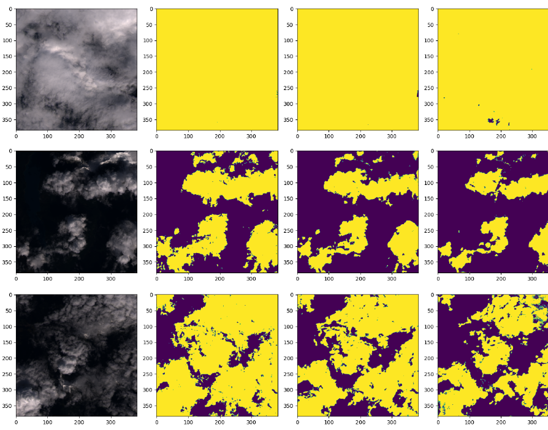
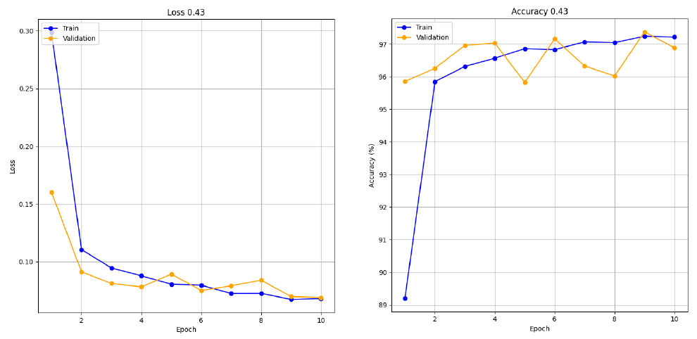
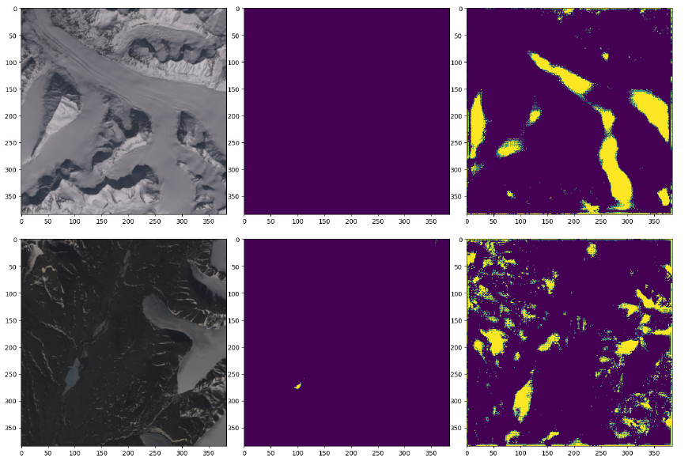

# Cloud Detection on 38-Cloud with U-Net

Pixel-wise cloud segmentation of Landsat 8 satellite imagery using a U-Net implemented from scratch in PyTorch.
This was my Bachelor's thesis project in Computer and Automation Engineering at Sapienza University of Rome (A.Y. 2023/2024, supervisor Prof. Thomas Alessandro Ciarfuglia).

The full write-up (in Italian) is in [`relazione.pdf`](relazione.pdf).

## Overview

Clouds hide the ground in a large share of Landsat scenes, so detecting them is a standard preprocessing step in remote sensing.
The model receives a 4-channel patch (Red, Green, Blue and Near-Infrared) and predicts a binary cloud / no-cloud mask for every pixel.

## Dataset

[38-Cloud](https://www.kaggle.com/datasets/sorour/38cloud-cloud-segmentation-in-satellite-images) contains 38 Landsat 8 scenes of North America, cut into 384×384 patches.
Each band is stored as a separate file, and the script combines the four bands into one input tensor.

The dataset has two problems that shaped most of the work:

- **Class imbalance.** About a third of the training patches are entirely black (no data), and non-cloud pixels outnumber cloud pixels by a wide margin.
- **Noisy ground truth.** The masks were labelled manually and are sometimes imprecise.

## Method

- **Model:** U-Net with a 64-128-256-512 encoder, a mirrored decoder with transposed convolutions and skip connections, and 2 output classes.
- **Loss:** weighted cross-entropy to compensate for the class imbalance. The weight for the non-cloud class was tuned (0.43, then 0.83 after cleaning).
- **Optimizer:** Adam with a learning-rate sweep from 1e-2 to 1e-5, batch size 8.
- **Augmentation:** random horizontal and vertical flips (Albumentations).
- **Model selection:** the checkpoint with the best validation F1-score is saved. F1 is used instead of accuracy, because accuracy stays around 96–98% even for a model that misses most clouds.
- **Data cleaning:** the 2,813 all-black patches were removed, leaving 5,587 patches (4,469 train / 1,118 validation). This cut training time and reduced the overestimation of cloud areas.

## Results

- Training for 10 epochs gave the best balance. At 30 epochs the F1-score rose to about 97%, but the predicted masks visibly overestimated the clouds, which points to overfitting around epoch 20.
- The model trained on the cleaned dataset was the best overall: it delineates cloud shapes well on dark or high-contrast backgrounds, correctly handles cloud-free patches, and catches thin clouds.

Validation predictions. From left to right: input patch, ground truth, model trained on the **cleaned** dataset, model trained on the **original** dataset. Yellow is cloud.

Training curves of the 10-epoch model (loss weight 0.43). Validation accuracy stays around 96–97% from the second epoch, which is why F1 was used for model selection instead.

### Failure case: snow and water

The main weakness is that snow, ice and water bodies are often classified as clouds. In the examples below (input, ground truth, prediction) the ground truth has almost no clouds, but the model marks the snowy ridges and the lake.

With only RGB and NIR bands, snow and clouds have similar reflectance. Thermal or SWIR bands and more snowy training samples (e.g. the [95-Cloud](https://github.com/SorourMo/95-Cloud-An-Extension-to-38-Cloud-Dataset) extension) would likely help.

## Repository contents

| File | Description |
|------|-------------|
| `38_cloud.py` | Full pipeline exported from Colab: data loading, dataset class, U-Net, training, validation and visualisation |
| `relazione.pdf` | Thesis report (Italian) |

## Running it

The code was written for Google Colab with a GPU and uses Colab-specific commands (`!pip`, `drive.mount`).
The easiest way to run it is the notebook:

**[Open in Colab](https://colab.research.google.com/drive/1o_vXwKJ-tUSLlE0lBFoPvBSHhS6VXaaC?usp=sharing)**. This is the full version, with all tested models, plots and prediction examples.

The dataset is downloaded through the Kaggle API, so you need a `kaggle.json` token in the Colab working directory.
Trained models and CSV logs are saved to Google Drive (`/content/drive/MyDrive/Tesi/`), so you will need to change that path to your own folder.

## Tech stack

Python · PyTorch · torchvision · Albumentations · scikit-learn · OpenCV · pandas · Matplotlib / Seaborn
